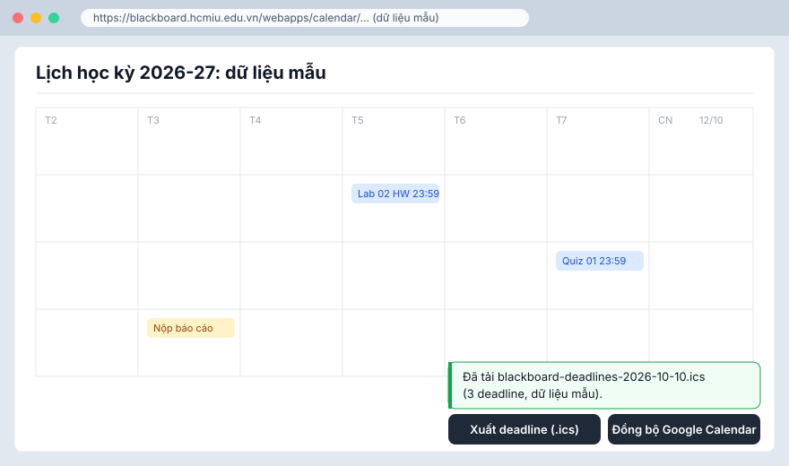
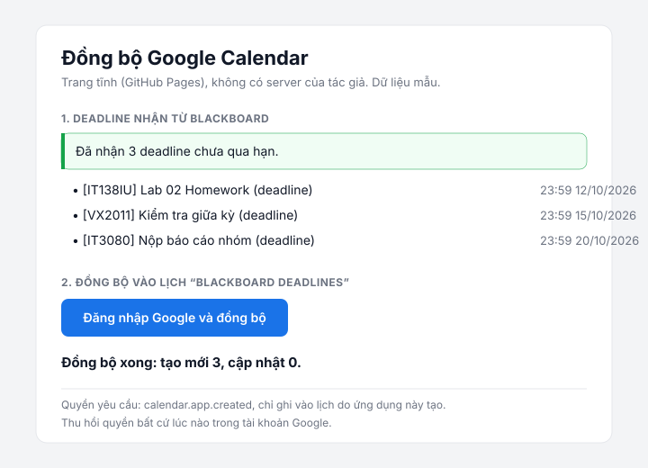

# Blackboard HCMIU Deadlines → Google Calendar

[English](#english) | [Tiếng Việt](#tiếng-việt)

---

## English

### 1. What it does

A small script for the Blackboard Learn calendar at HCMIU — run it with Tampermonkey,
a bookmarklet, or as a plain browser extension. Press a button and it collects your
**upcoming deadlines** (past ones are never exported) and either:

- **Phase 1 (required):** downloads an `.ics` file you import into Google Calendar, or
- **Phase 2 (optional):** writes them straight into a Google Calendar named
  **"Blackboard Deadlines"** through a static page plus an Apps Script relay — no
  manual import, and **no Google setup at all** for the people using it.

Everything runs in **your browser**. There is no author server, no analytics, and no
data collection. The script only reads deadlines for the next 180 days (configurable)
and filters out anything already past its end time.

### 2. Install

Pick one option — all three run the same code:

**Option 1 — Tampermonkey (easiest to update)**

1. Install [Tampermonkey](https://www.tampermonkey.net/) (or Violentmonkey).
2. Open [`blackboard-deadlines.user.js`](./blackboard-deadlines.user.js) in this repo,
   view the **Raw** file, and confirm the install.

**Option 2 — Bookmarklet (nothing to install)**

1. Create a new browser bookmark and paste the `javascript:...` line from
   [`bookmarklet/bookmarklet.js`](./bookmarklet/bookmarklet.js) into its URL field
   (first change the placeholder to the URL where you host the script).
2. On the Blackboard calendar page, click the bookmark — the buttons appear.
   - If nothing happens, the Blackboard page's CSP may block injected scripts; use
     option 1 or 3 instead.

**Option 3 — Browser extension (no Tampermonkey)**

1. Build once: `node build.js` (this also generates `extension/bb.js`).
2. Load it: Chrome/Edge → `chrome://extensions` → Developer mode → **Load unpacked**
   → pick the [`extension/`](./extension/) folder; Firefox → `about:debugging` →
   **Load Temporary Add-on** → pick `manifest.json`.
3. To distribute to everyone: submit the `extension/` folder to the Chrome Web Store
   or Firefox Add-ons. The manifest requests **no extra permissions**.

Building from source (optional): `node build.js` — no npm dependencies.
Phase 2 additionally needs the one-time relay setup in [Usage B](#3-usage);
Phase 1 needs none of that.

### 3. Usage

#### A — One-time `.ics` export (Phase 1)

1. Open <https://blackboard.hcmiu.edu.vn/webapps/calendar/> and log in.
2. Click **"Xuất deadline (.ics)"** (floating, bottom-right).
   File `blackboard-deadlines-YYYY-MM-DD.ics` downloads.
   - No upcoming deadlines? You'll see: *"Không có deadline nào sắp tới."*
   - Logged out? *"Phiên đăng nhập có thể đã hết hạn…"*
3. In Google Calendar: **Settings ⚙ → Import & export → Import**, pick the file,
   choose a calendar, press **Import**.
4. Times are correct for Vietnam: each event is a 30-minute block that **ends exactly
   at the deadline** (Google Calendar rejects zero-length events). All-day deadlines
   become full-day events.

Re-importing the same file later **updates** the same events instead of duplicating
them (fixed UID per Blackboard item).

#### B — Direct Google Calendar sync (Phase 2, optional)

One person (the *operator*) sets this up once; everyone else just presses the button.
Both Apps Script and GitHub Pages are free.

1. **Deploy the relay.** Open <https://script.new> (logged in with the Google account
   that should own the calendar) and paste [`apps-script/Code.gs`](./apps-script/Code.gs),
   **Save**, then *Deploy → New deployment → **Web app***:
   - **Execute as: User accessing the app**, **Who has access: Anyone** → **Deploy**
     → copy the URL ending in `/exec`.
2. **Host the sync page.** Publish this repo on GitHub Pages
   (*Settings → Pages → Deploy from a branch → `main` / root*), giving you
   `https://<your-user>.github.io/<repo>/sync/`.
3. **Configure, build, install.**
   - Set `RELAY_URL` in [`sync/sync.js`](./sync/sync.js) to the `/exec` URL from step 1.
   - Set `BB_CONFIG.SYNC_PAGE_URL` in [`src/userscript.body.js`](./src/userscript.body.js)
     to your sync URL, run `node build.js`, then reinstall/reload whichever option you
     picked in §2.
4. **Use it — everyone syncs into their own calendar.** On the Blackboard calendar
   click **"Đồng bộ Google Calendar"** → the page lists your upcoming deadlines →
   press **"Đồng bộ vào Google Calendar"**. A popup opens:
   - **First run:** Google asks you to authorize the script once. Seeing *"This app
     isn't verified" → Advanced → Go to (unsafe)* is normal for a small script (the
     operator can submit it for verification later). Press Allow, close the popup,
     press the sync button again.
   - **Every later run:** the popup shows *"Đồng bộ xong: tạo mới X, cập nhật Y."*
     and closes itself. Events land in **your own** "Blackboard Deadlines" calendar,
     created automatically on first sync.

Notes:

- Everyone writes to **their own** Google calendar: the relay runs as the person
  clicking (*Execute as: User accessing*). No Client ID, no test-user limit, no OAuth
  verification required — only the one-time in-popup consent.
- The sync page sends events through a **popup form POST** (a real navigation, so the
  browser carries your Google session; a cross-origin fetch would be blocked).
- **Re-running is safe:** every event keeps a fixed ID, syncing again updates instead
  of duplicating (insert → 409 → patch happens inside the script). Nothing is ever
  deleted automatically.
- **The script requests full Calendar access** (`https://www.googleapis.com/auth/calendar`)
  because Apps Script's Calendar service has no narrower scope. It only creates and
  updates your "Blackboard Deadlines" calendar — but Google's consent wording is
  broader; that is Google's screen, not ours.
- **Optional abuse guard:** set a Script Property `token` in Apps Script (*Project
  Settings → Script properties*) and put the same value into `RELAY_TOKEN` in
  [`sync/sync.js`](./sync/sync.js).
- Anyone who cannot or does not want to use Phase 2 still fully has Phase 1.

### 4. Limitations

- The `selectedCalendarEvents` endpoint is **not a public API**. It is what the
  Blackboard web UI itself calls; if the school or Blackboard changes its
  configuration, the tool may break.
- **Deadlines only** (assignments/due dates) — no class schedule, no exam timetable.
- **No background job:** nothing runs automatically; open Blackboard and press the
  button each time.
- Phase 1 is a **one-time snapshot**. If you previously imported the same deadlines
  another way (e.g. Blackboard's own feed), you may get duplicates — delete the old
  entries first.
- **Nothing is ever deleted automatically.** If a deadline is deleted or its time is
  changed on Blackboard, the copy in Google Calendar stays until you remove or
  re-sync it. Re-syncing updates times but does not delete vanished events.
- The `.ics` `SEQUENCE` field is set to the current minute so a later import looks
  "newer" than an earlier one. **Not verified** that Google Calendar uses it to update
  existing entries — if duplicates appear, delete the old ones and import again.
- Phase 2 pop-up windows may be blocked by the browser — allow pop-ups for Blackboard.
- Phase 2 sends deadline titles and times to the Apps Script relay endpoint; the
  `/exec` URL is effectively public — use the optional token if that bothers you.

### 5. Privacy & Security

- **Everything runs in your browser.** No author server, no data collection, no
  tracking, no cookies set by this project.
- The script calls only: `blackboard.hcmiu.edu.vn` (same-origin `fetch` with
  `credentials: 'same-origin'`) and your sync page; only the sync page then calls
  `script.google.com` (the relay). It never uses `GM_xmlhttpRequest`.
- **Nothing is stored in your browser.** Phase 2 asks for a one-time Google consent
  for the Apps Script (inside the popup); the script then writes into **your own**
  "Blackboard Deadlines" calendar using your own Google authorization.
- Phase 2 exchanges data with `postMessage`: **both sides verify `event.origin`**
  (and the sending window), validate the message schema **and a per-click nonce**,
  never use `targetOrigin "*"`, and never put event data in a URL.
- **Read the source before installing**, and never share your personal Blackboard
  `.ics` feed link — it contains your schedule.

### 6. Disclaimer

Personal, unofficial project. Not affiliated with, endorsed by, or supported by
HCMIU or Blackboard. **No warranty** of any kind; use at your own risk. It may stop
working when the university changes its Blackboard setup.

### 7. Contributing & License

- **MIT** — see [LICENSE](./LICENSE). Issues and pull requests are welcome.
- Development: `node build.js` regenerates the userscript and `extension/bb.js`;
  `npm test` (or `node build.js && node test/test.js`) runs the Node test suite —
  plain Node ≥ 18, **no dependencies, no test framework**.
- Layout: `src/core.js` (pure functions: filtering, time zones, escaping, line
  folding, ICS/Google payloads), `src/userscript.body.js` (DOM/fetch thin layer),
  `sync/` (Phase 2 page), `apps-script/` (Phase 2 relay), `extension/` (MV3 wrapper),
  `bookmarklet/`, `test/test.js` (fake data only), `build.js` (concatenation).

[↑ Top](#top) · [Tiếng Việt](#tiếng-việt)

---

## Tiếng Việt

### 1. Tool làm gì

Script nhỏ cho trang Calendar của Blackboard Learn trường HCMIU — chạy bằng
Tampermonkey, bookmarklet, hoặc cài như extension trình duyệt bình thường. Bấm một
nút, script lấy các deadline **chưa qua hạn** (deadline đã qua không bao giờ được
xuất) rồi:

- **Giai đoạn 1 (bắt buộc):** tải file `.ics` để bạn import vào Google Calendar, hoặc
- **Giai đoạn 2 (tùy chọn):** ghi thẳng vào lịch **"Blackboard Deadlines"** thông qua
  trang tĩnh cộng một Apps Script relay — không cần import thủ công, và **không cần
  cài đặt gì về Google** cho người dùng.

Mọi thứ chạy trong **trình duyệt của bạn**. Không có server của tác giả, không có
analytics, không thu thập dữ liệu. Script chỉ đọc cửa sổ 180 ngày tới (đổi được) và
lọc mọi sự kiện đã qua hạn.

### 2. Cài đặt

Chọn 1 trong 3 cách — cùng một mã nguồn:

**Cách 1 — Tampermonkey (dễ cập nhật nhất)**

1. Cài [Tampermonkey](https://www.tampermonkey.net/) (hoặc Violentmonkey).
2. Mở [`blackboard-deadlines.user.js`](./blackboard-deadlines.user.js) trong repo, xem
   file **Raw**, rồi xác nhận cài.

**Cách 2 — Bookmarklet (không cài gì)**

1. Tạo bookmark mới và dán dòng `javascript:...` từ
   [`bookmarklet/bookmarklet.js`](./bookmarklet/bookmarklet.js) vào trường URL
   (đổi placeholder thành URL nơi bạn host script).
2. Ở trang Calendar Blackboard, bấm bookmark đó là nút hiện ra.
   - Nếu không có gì xảy ra, CSP của Blackboard có thể chặn inject script; dùng cách 1
     hoặc cách 3.

**Cách 3 — Extension trình duyệt (không cần Tampermonkey)**

1. Build một lần: `node build.js` (tự sinh thêm `extension/bb.js`).
2. Nạp extension: Chrome/Edge → `chrome://extensions` → Bật **Developer mode** →
   **Load unpacked** → chọn thư mục [`extension/`](./extension/); Firefox →
   `about:debugging` → **Load Temporary Add-on** → chọn `manifest.json`.
3. Muốn chia sẻ cho mọi người: submit thư mục `extension/` lên Chrome Web Store hoặc
   Firefox Add-ons. Manifest **không xin quyền thừa**.

Tự build từ nguồn (không bắt buộc): `node build.js` — không cần npm dependency.
Giai đoạn 2 cần thêm cấu hình relay một lần ở [Cách dùng B](#3-cách-dùng);
Giai đoạn 1 không cần gì thêm.

### 3. Cách dùng

#### A — Xuất `.ics` một lần (Giai đoạn 1)

1. Mở <https://blackboard.hcmiu.edu.vn/webapps/calendar/> và đăng nhập.
2. Bấm **"Xuất deadline (.ics)"** (nút nổi góc dưới phải). File
   `blackboard-deadlines-YYYY-MM-DD.ics` sẽ được tải về.
   - Không có deadline sắp tới? Thông báo: *"Không có deadline nào sắp tới."*
   - Hết phiên đăng nhập? *"Phiên đăng nhập có thể đã hết hạn…"*
3. Trên Google Calendar: **Settings ⚙ → Import & export → Import**, chọn file, chọn
   lịch đích, bấm **Import**.
4. Giờ đúng múi giờ Việt Nam: mỗi sự kiện là khối 30 phút **kết thúc chính xác tại
   hạn nộp** (Google Calendar không nhận sự kiện độ dài 0). Deadline cả ngày thành
   sự kiện trọn ngày.

Import lại cùng file sau này sẽ **cập nhật** đúng các sự kiện cũ thay vì nhân đôi
(UID cố định theo từng mục Blackboard).

#### B — Đồng bộ thẳng vào Google Calendar (Giai đoạn 2, tùy chọn)

Một người (gọi là *người vận hành*) cấu hình một lần; mọi người còn lại chỉ bấm nút.
Apps Script và GitHub Pages đều miễn phí.

1. **Deploy relay.** Mở <https://script.new> (đăng nhập bằng tài khoản Google sẽ giữ
   lịch), dán [`apps-script/Code.gs`](./apps-script/Code.gs), **Save**, rồi
   *Deploy → New deployment → **Web app***:
   - **Execute as: User accessing the app**, **Who has access: Anyone** → **Deploy**
     → copy URL kết thúc `/exec`.
2. **Đưa trang sync lên mạng.** Publish repo này bằng GitHub Pages
   (*Settings → Pages → Deploy from a branch → `main` / root*), ra
   `https://<user-của-bạn>.github.io/<repo>/sync/`.
3. **Cấu hình, build, cài lại.**
   - Đặt `RELAY_URL` trong [`sync/sync.js`](./sync/sync.js) thành URL `/exec` ở bước 1.
   - Đặt `BB_CONFIG.SYNC_PAGE_URL` trong [`src/userscript.body.js`](./src/userscript.body.js)
     đúng URL trang sync, chạy `node build.js`, rồi cài lại/nạp lại cách bạn đã chọn ở
     mục 2.
4. **Dùng — mỗi người ghi vào lịch của chính mình.** Trên trang Calendar Blackboard
   bấm **"Đồng bộ Google Calendar"** → trang liệt kê deadline chưa qua hạn → bấm
   **"Đồng bộ vào Google Calendar"**. Cửa sổ popup mở ra:
   - **Lần đầu:** Google hỏi bạn ủy quyền script 1 lần. Màn hình *"This app isn't
     verified" → Advanced → Go to (unsafe)* là bình thường với script nhỏ (người vận
     hành có thể gửi xác minh sau). Bấm Allow, đóng popup, bấm Đồng bộ lần nữa.
   - **Các lần sau:** popup hiện *"Đồng bộ xong: tạo mới X, cập nhật Y."* rồi tự
     đóng. Sự kiện nằm trong lịch **"Blackboard Deadlines" của chính bạn**, tự tạo ở
     lần đồng bộ đầu.

Ghi chú:

- **Mỗi người ghi vào lịch của chính mình:** relay chạy bằng tài khoản của người đang
  bấm (*Execute as: User accessing*). Không Client ID, không giới hạn 100 test user,
  không cần xác minh OAuth — chỉ có màn hình ủy quyền 1 lần trong popup.
- Trang sync gửi sự kiện qua **popup form POST** (điều hướng thật nên trình duyệt mang
  theo phiên Google của bạn; fetch cross-origin sẽ bị chặn).
- **Đồng bộ lại an toàn:** mỗi sự kiện có ID cố định, chạy lại là cập nhật chứ không
  nhân đôi (insert → 409 → patch nằm trong script). Không có gì bị tự xóa.
- **Script xin quyền toàn bộ lịch** (`https://www.googleapis.com/auth/calendar`) vì
  dịch vụ Calendar của Apps Script không có scope hẹp hơn. Thực tế nó chỉ tạo/cập nhật
  lịch "Blackboard Deadlines" — nhưng lời mời đồng ý của Google rộng hơn; đó là màn
  hình của Google, không phải của mình.
- **Chống spam tùy chọn:** đặt Script Property `token` trong Apps Script (*Project
  Settings → Script properties*) và điền cùng giá trị vào `RELAY_TOKEN` trong
  [`sync/sync.js`](./sync/sync.js).
- Ai không dùng Giai đoạn 2 vẫn dùng được đầy đủ Giai đoạn 1.

### 4. Giới hạn

- Endpoint `selectedCalendarEvents` **không phải API công khai** — đây là endpoint mà
  chính giao diện Blackboard gọi. Blackboard hoặc trường đổi cấu hình thì tool có thể
  hỏng.
- **Chỉ có deadline** (bài tập, hạn nộp) — không có lịch học hay lịch thi.
- **Không tự chạy ngầm:** mỗi lần dùng phải mở Blackboard và bấm nút.
- Cách A là **bản chụp một lần**. Nếu trước đó bạn đã import cùng deadline theo cách
  khác (vd: feed của Blackboard) thì có thể bị trùng — xóa bản cũ trước khi import.
- **Không tự xóa sự kiện:** deadline bị xóa hoặc đổi giờ trên Blackboard sẽ *không*
  tự biến mất/cập nhật trên Google Calendar cho tới khi bạn đồng bộ lại — và dù đồng
  bộ lại, sự kiện biến mất khỏi Blackboard cũng không bị xóa ở Google.
- `SEQUENCE` trong `.ics` lấy theo phút hiện tại để bản import sau "mới hơn" bản
  trước. **Chưa kiểm chứng** Google Calendar có dùng giá trị này để cập nhật sự kiện
  trùng UID hay không — nếu bị trùng, xóa bản cũ rồi import lại.
- Trang sync bật cửa sổ mới — trình duyệt có thể chặn pop-up; hãy cho phép pop-up
  cho Blackboard.
- Giai đoạn 2 gửi tiêu đề và giờ hạn nộp tới Apps Script relay endpoint; URL `/exec`
  mặc nhiên công khai — dùng token tùy chọn nếu bạn thấy ngại.

### 5. Quyền riêng tư và bảo mật

- **Mọi thứ chạy trong trình duyệt của bạn.** Không có server của tác giả, không thu
  thập dữ liệu, không analytics, dự án này không đặt cookie nào.
- Script chỉ gọi: `blackboard.hcmiu.edu.vn` (fetch cùng domain với
  `credentials: 'same-origin'`) và trang sync; chỉ trang sync gọi tiếp
  `script.google.com` (relay). Không dùng `GM_xmlhttpRequest`.
- **Không lưu gì trong trình duyệt của bạn.** Giai đoạn 2 chỉ xin ủy quyền Apps Script
  1 lần (trong popup); script ghi vào **lịch "Blackboard Deadlines" của chính bạn**
  bằng ủy quyền Google của bạn.
- Giai đoạn 2 trao đổi dữ liệu qua `postMessage`: **cả hai phía đều kiểm tra
  `event.origin`** (và cửa sổ gửi), validate cấu trúc thông điệp **và nonce mỗi lần
  bấm**, không dùng `targetOrigin "*"`, không đưa dữ liệu sự kiện lên URL.
- **Khuyến khích đọc mã nguồn trước khi cài**, và không chia sẻ link feed `.ics` cá
  nhân của Blackboard — nó chứa lịch của chính bạn.

### 6. Tuyên bố

Dự án cá nhân, **không phải sản phẩm chính thức** của trường HCMIU hay Blackboard,
không liên kết, không được bảo trợ. **Không bảo hành** bất kỳ dạng nào; dùng tự chịu
rủi ro. Tool có thể ngừng hoạt động khi trường thay đổi cấu hình Blackboard.

### 7. Đóng góp và giấy phép

- **MIT** — xem [LICENSE](./LICENSE). Issues và pull request đều hoan nghênh.
- Phát triển: `node build.js` để tạo lại userscript và `extension/bb.js`; `npm test`
  (hoặc `node build.js && node test/test.js`) chạy test — Node ≥ 18 thuần,
  **không thư viện ngoài, không framework test**.
- Cấu trúc: `src/core.js` (hàm thuần: lọc, múi giờ, escape, gập dòng, dựng ICS/nội
  dung Google), `src/userscript.body.js` (lớp mỏng DOM/fetch), `sync/` (trang Giai
  đoạn 2), `apps-script/` (relay Giai đoạn 2), `extension/` (bọc MV3), `bookmarklet/`,
  `test/test.js` (chỉ dữ liệu giả), `build.js` (ghép file).

[↑ Top](#top) · [English](#english)
